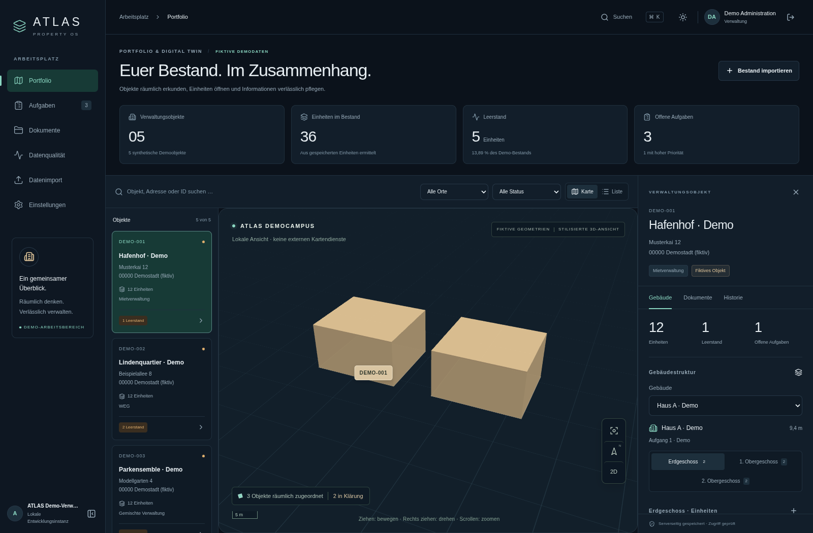

# ATLAS Property OS

Ein lokal ausführbarer, deutschsprachiger Verwaltungsprototyp: räumlicher Überblick, Liegenschaften, Gebäude, Etagen, Einheiten, geschützte Grundrisse, Aufgaben, geprüfte Datenimporte und nachvollziehbare Änderungen.

**Der öffentliche Repository-Stand enthält ausschließlich synthetische Beispieldaten.** Echte Portfoliolisten, Personen und Pläne bleiben in `imports/` beziehungsweise im privaten Anwendungsspeicher. Es gibt keine aktive Aareon-, Bank-, Geocoding- oder KI-Anbindung und keine behauptete rechtliche, buchhalterische oder Datenschutz-Zertifizierung.

## Vorschau



Die Aufnahme stammt aus der tatsächlich gestarteten Anwendung mit ausschließlich fiktiven Testdaten. [Light Mode ansehen](docs/screenshots/portfolio-light.png).

## Website öffnen

**[Privaten ATLAS-Arbeitsbereich öffnen](https://neuhaus-objektkarte-dinslaken.fhfhzfmsqw.chatgpt.site)**. Der Zugang erfolgt über das berechtigte ChatGPT-Konto. Für die Website sind keine Installation, Terminalbefehle oder Demo-Zugangsdaten nötig.

Die gehostete Variante unter `apps/hosted` speichert Angaben und Originaldateien serverseitig. Der übernommene Erstbestand enthält 36 reale Verwaltungsobjekte und drei amtlich zugeordnete Außenmodelle; weitere Standorte, Einheiten und Mieterdetails werden nur aus vorliegenden Angaben erfasst. Nutzungsumfang und Abschlussprüfung: **[Website-Anleitung](docs/HOSTED_WEBSITE.md)**.

Die folgenden Installationsanweisungen richten sich an die Entwicklung des separaten Next.js-/PostgreSQL-Prototyps. Für eine Entwicklungsumgebung im Browser gibt es weiterhin die [Codespaces-Anleitung](docs/OPEN_IN_BROWSER.md).

## Lokal starten

Voraussetzungen: Node.js **24+**, pnpm **11.25.0**, Docker mit Compose. Die Ports 3000, 5432 und 9000 müssen frei sein. Falls pnpm fehlt: `npm install --global pnpm@11.25.0`.

```bash
git clone https://github.com/steutersimon-a11y/hausverwaltung.git
cd hausverwaltung
pnpm run setup
pnpm dev
```

Öffnen: **http://127.0.0.1:3000**. Verwende diese Adresse auch für Anmeldung und Tests, damit Origin und Cookie-Scopes zur Konfiguration passen.

`pnpm run setup` installiert die gesperrten Abhängigkeiten, legt eine ignorierte `.env` mit zufälligen lokalen Secrets an, startet PostgreSQL/PostGIS und einen privaten S3-kompatiblen SeaweedFS-Speicher, wendet Migrationen an und legt die fiktive Demo an. Bestehende Konfiguration und Daten werden nicht zurückgesetzt.

### Synthetische Demo-Zugänge

Alle folgenden Konten sind ausschließlich für eine isolierte lokale Installation gedacht. Kennwort: **`Atlas-Demo-2026!`**.

| Konto | Rechte |
|---|---|
| `admin@atlas.example` | Administration innerhalb der Demo-Verwaltung |
| `editor@atlas.example` | Bearbeitung des ausdrücklich zugewiesenen Objekts |
| `readonly@atlas.example` | Lesen des ausdrücklich zugewiesenen Objekts |
| `extern@atlas.example` | Andere Demo-Organisation; kein Zugriff auf den ersten Bestand |

Die Demo enthält drei fiktive Liegenschaften mit sechs Gebäuden, 18 Geschossen und 36 Einheiten sowie einen ungeklärten vierten Datensatz ohne erfundene Kartenposition. Demoadressen und Geometrien beschreiben keinen echten Verwaltungsbestand.

## Einen vollständigen Ablauf ausprobieren

1. Anmelden, ein Objekt in der Liste oder auf der Karte auswählen, Gebäude und Geschoss wechseln, eine Einheit öffnen.
2. Fläche, Zimmer, Status oder Notiz ändern und speichern. Nach Neuladen bleibt die Änderung erhalten; die Historie zeigt die versionierte Änderung. Veraltete Revisionen werden abgelehnt.
3. Einen echten Testgrundriss als PDF oder Bild hochladen. Das Original liegt privat im S3-Speicher; Anzeige und Download prüfen die Berechtigung erneut. Bilder lassen sich vergrößern und drehen. Ein Upload erzeugt kein maßgeprüftes 3D-Innenmodell.
4. Eine Aufgabe anlegen, bearbeiten und abschließen; der Verlauf bleibt zugeordnet.
5. Unter „Datenimport“ CSV/JSON oder einen Screenshot hochladen. Screenshotzeilen werden manuell erfasst, nicht als ungeprüfte OCR ausgegeben. Zeilen korrigieren, Herkunft/Verwaltungsart prüfen, bestätigen und ausdrücklich übernehmen. Wiederholte Übernahme erzeugt keine Dubletten. Bestandskonflikte bleiben blockiert.

Die Kartenbasis ist standardmäßig vollständig lokal und schematisch. Nur freigegebene beziehungsweise klar synthetische Geometrien erscheinen auf der Karte. Externe Kartendienste sind optional und bewusst zu konfigurieren; keine Satellitenansicht wird vorgetäuscht.

## Entwicklung und Prüfungen

```bash
pnpm lint
pnpm typecheck
pnpm test
pnpm test:integration
pnpm build
pnpm test:e2e
```

Für Integrationstests müssen die lokalen Dienste laufen und Migrationen/Seed angewendet sein. Playwright startet die App selbst oder verwendet einen bereits laufenden lokalen Entwicklungsserver. Wenn kein System-Chromium vorhanden ist: `pnpm exec playwright install --with-deps chromium`. Alternativ `PLAYWRIGHT_CHROMIUM_EXECUTABLE` auf eine vorhandene Chromium-Datei setzen.

Einzelne Einrichtungsschritte:

```bash
node scripts/setup.mjs --env-only
pnpm services:up
pnpm db:migrate
pnpm db:seed
pnpm services:down
```

`services:down` erhält die Datenvolumes. Die Seed-Ausführung ist idempotent; in einer Produktionsumgebung ist sie standardmäßig gesperrt. Das MFA-Plugin ist vorbereitet; ein vollständiger MFA-Einrichtungsdialog und ein produktiver Benutzerlebenszyklus sind noch offen.

## Echte Portfoliodaten weiterverwenden

Die im Chat übergebenen Screenshots wurden bereits lokal in eine prüfbare Liste übertragen. Diese Dateien und die abgerufenen amtlichen Gebäudemodelle gehören in **`imports/` und werden nicht committed**. Nach einem frischen Clone sind sie dort deshalb nicht enthalten. Lade die Daten anschließend über den geschützten Review-Workflow hoch und bestätige die einzelnen Zeilen. Fehlende Angaben bleiben unbekannt; Gebäudemodelle und Grundrisse werden nicht aus Adressen erfunden.

CSV/JSON-Felder und Grenzen: [Importe und Integrationen](docs/IMPORTS_AND_INTEGRATIONS.md). XLSX, automatische OCR, Aareon-Konkretadapter, Zahlungsabgleich, vollständige WEG-Verwaltung und ein IFC-/GLB-Importdialog sind spätere Arbeitspakete. Vorhandene echte GLB-Dateien sind keine automatisch geprüften Architekturmodelle.

## Aufbau

```text
apps/web             Next.js 16, React, API, geschützte Oberfläche
packages/db          Drizzle-Schema, SQL-Migrationen, browserfähige DTOs
packages/domain      Gemeinsame fachliche Grundlagen; weitere Fachmodule folgen
packages/integrations Begrenzte Parser und Importverträge
scripts              Lokales Setup, Migration/Seed-Start
tests                Upload-, Karten-, Import-, DB- und Browserprüfungen
docs                 Architektur, Schutzmodell, Entscheidungen, Roadmap
imports              Ignorierte echte Eingabedaten
```

## Troubleshooting

- **Anmeldung/Änderung 403:** Browseradresse und `APP_URL` müssen dieselbe Origin haben. Kein Wechsel zwischen `localhost` und `127.0.0.1` während einer Sitzung.
- **Anmeldung 429:** Der Auth-Provider begrenzt wiederholte Anmeldungen. Die angegebene Wartezeit einhalten; Tests respektieren dieselbe Begrenzung.
- **DB nicht erreichbar:** `docker compose ps` prüfen, dann `pnpm db:migrate` ausführen. Keine Volumes zum Beheben eines Konfigurationsfehlers löschen.
- **Uploads nicht erreichbar:** `docker compose ps objectstore` prüfen; S3-Endpoint, Bucket und Zugangskonfiguration müssen zusammenpassen. Niemals Secrets in Fehlerberichte kopieren.
- **Wenig Speicher in einer Cloud-Sandbox:** Docker mit VFS kann Images mehrfach speichern. Die Entwicklung hier verwendete nur temporäre, identische, flache lokale Image-Kopien; normale Docker-Installationen benötigen diese Anpassung nicht. Siehe [Validierung](docs/VALIDATION.md).
- **pnpm-Cache nicht beschreibbar:** In einer eingeschränkten Umgebung einen eigenen `XDG_DATA_HOME`, `XDG_CACHE_HOME` und `XDG_STATE_HOME` im Arbeitsbereich verwenden. Keine fremden Caches oder Nutzerdaten entfernen.
- **Kein WebGL:** Die vollständige Listenansicht bleibt bedienbar.

Prüfergebnisse: [Validierung](docs/VALIDATION.md). Noch offene Arbeit: [Roadmap](docs/ROADMAP.md). Betrieb und Wiederherstellung: [Deployment](docs/DEPLOYMENT.md), [Backup/Restore](docs/BACKUP_AND_RESTORE.md). Verbindliche Arbeitsregeln: [AGENTS.md](AGENTS.md).
