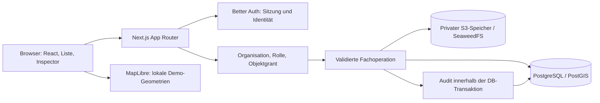

# Architektur

## Entscheidung und Umfang

ATLAS ist ein modularer Monolith mit einer Next.js-Webanwendung, einer PostgreSQL-Datenbank und einem privaten S3-kompatiblen Dateispeicher. Der Kernprototyp wird lokal betrieben. Eine registrierte Produktionsinstanz, ein reales ERP oder ein Bankingdienst sind keine Voraussetzung.

Der aktuelle Implementierungsstand und noch ausstehende Abnahme stehen in [ROADMAP.md](ROADMAP.md). Bibliotheksversionen werden über die Paketdateien und den Lockfile festgelegt. Architekturentscheidungen sind unter [adr](adr/) dokumentiert.



## Modulgrenzen

| Pfad | Verantwortung |
| --- | --- |
| `apps/web/src/app` | Seiten, serverseitige Endpunkte, Auth-Transport |
| `apps/web/src/components` | Präsentation, Formulare, Karte und Detailinspector |
| `apps/web/src/lib/server` | Auth-Konfiguration, Zugriffsschutz, Domain- und Storageoperationen |
| `packages/db/src/schema.ts` | Drizzle-Schema und DB-Beziehungen |
| `packages/db/src/contracts.ts` | Browsergeeignete DTOs ohne Laufzeit-DB-Import |
| `packages/db` | SQL-Migrationen, DB-Verbindung und Migrationseintrittspunkt |
| `scripts/seed.ts` | Ausschließlich synthetische lokale Testorganisationen und Daten |
| `imports/` | Lokal ignorierte Eingabedateien; kein öffentliches Seed-Verzeichnis |

Zusätzliche Pakete für Fachlogik, UI oder Integrationen entstehen bei einem konkreten gemeinsamen Anwendungsfall. Ein leeres Microservice- oder Adaptergerüst ist kein fertiges Modul.

## Lokale Laufzeit

Die bestätigte lokale Infrastruktur besteht aus `postgis/postgis:17-3.5-alpine` und `chrislusf/seaweedfs:4.38`. SeaweedFS läuft im Compose-Service `objectstore` mit `weed mini`; der Einstiegspunkt des Images ergänzt dabei den Befehl `weed`. Das Volume `atlas_objects` hält die Dateien. Nur die S3-Schnittstelle ist auf `127.0.0.1:9000` veröffentlicht; interne Verwaltungsports bleiben im Containernetz. Der S3-Client verwendet weiterhin das anbieterneutrale S3-Protokoll. [SeaweedFS Quick Start](https://github.com/seaweedfs/seaweedfs#quick-start)

Der Paketstand dieses Arbeitslaufs ist pnpm 11.25.0, Next.js 16.4.5, React 19.3.1, TypeScript 5.9.3, MapLibre 6.16.0 und Better Auth 1.7.18. Für eine Reproduktion sind die Paketdateien und der Lockfile maßgeblich; Updates müssen erneut gemeinsam geprüft werden.

## Authentifizierung und Objektberechtigung

Better Auth verwaltet Passwörter, Sitzungen und den Auth-Endpunkt `/api/auth/[...all]`. Die eigene Fachautorisierung prüft eine Membership und den zugehörigen Objektzugriff. Eine Rolle aus dem Auth-Provider wird nicht als pauschaler Datenzugriff interpretiert.

| Rolle | Leserecht | Schreibrecht |
| --- | --- | --- |
| `admin`, `manager` | Objekte der eigenen Organisation | Erlaubte Fachoperationen der eigenen Organisation |
| `editor` | Explizit freigegebene Objekte | Nur bei schreibendem Objektgrant und erlaubter Operation |
| `viewer` | Explizit freigegebene Objekte | Keines |

Unauthentifizierte Anfragen erhalten `401`. Fremde oder nicht freigegebene Objekte werden wie nicht vorhandene Objekte behandelt (`404`). Ein sichtbares Objekt ohne Schreibrecht liefert bei einer Mutation `403`. Dieselbe Prüfung gilt für Einheitendetails, Auditdaten, Dokumentmetadaten und Dateiinhalte.

## API des Kernablaufs

Die verbindlichen DTOs stehen in `packages/db/src/contracts.ts`. Endpunkte verwenden `/api/atlas` als Präfix.

| Endpunkt | Zweck |
| --- | --- |
| `GET /portfolio` | Berechtigter Bestand mit aggregierten Kennzahlen, Organisation und Rolle |
| `GET /properties/:id` | Objekt, Gebäude, optionale Eingänge, Geschosse, Einheiten und zugehörige Historie |
| `GET /units/:id` | Einheit, berechtigte Beziehungen, Dokumente, Aufgaben und Historie |
| `PATCH /units/:id` | Validierte Bearbeitung mit übermittelter Revision |
| `GET /documents` | Berechtigte Dokumentmetadaten; Filter nach Objekt/Einheit |
| `POST /documents` | Multipart-Upload mit fachlicher Zuordnung und Inhaltsprüfung |
| `GET /documents/:id/content` | Erneut autorisierter Dateistream aus privatem Speicher |
| `GET /tasks`, `POST /tasks` | Berechtigte Aufgaben lesen beziehungsweise anlegen |
| `PATCH /tasks/:id` | Aufgabe mit Revisionsprüfung bearbeiten |

Eine aufgeführte Route beschreibt den vereinbarten Kernvertrag; ihre ausgeführte Abnahme wird getrennt erfasst. Finanz-, Import- und Aareon-Routen gelten erst mit eigener Implementierung und Tests als verfügbar.

## Konsistenz einer Änderung

```mermaid
sequenceDiagram
    actor Nutzer
    participant UI
    participant API
    participant DB
    Nutzer->>UI: Einheit ändern
    UI->>API: PATCH mit Revision
    API->>API: Sitzung, Scope, Origin, Schema prüfen
    API->>DB: Transaktion: UPDATE mit erwarteter Revision
    alt Revision passt
      API->>DB: Revision erhöhen und Audit-Ereignis anlegen
      DB-->>API: Commit
      API-->>UI: Gespeicherte Daten
    else Paralleländerung
      DB-->>API: Kein passender Datensatz
      API-->>UI: 409 Konflikt; erneut laden
    end
```

Die Datenbank erzwingt referenzielle Integrität und eindeutige fachliche Schlüssel. Fremde Mandanten dürfen nicht über einen einzelnen erratbaren UUID-Parameter zugänglich werden. PostgreSQL Row Level Security ist eine zusätzliche mögliche Schutzschicht; der Prototyp darf nicht behaupten, dass sie ohne ausdrücklich aktivierte Policies greift.

## Karte und Dateien

Die Karte lädt nur freigegebene Objekt-/Gebäudegeometrien und aggregierte Statuswerte. Standardmäßig entsteht die neutrale Kartenfläche lokal ohne externe Basiskarte, Telemetrie oder Geocoding. Kamera und Auswahl ändern keine Fachdaten. Eine Liste bleibt bei WebGL-Ausfall nutzbar.

Die Dateiablage trennt DB-Metadaten, Version und Binärinhalt. Der Browser erhält eine Anwendungsroute statt eines öffentlichen Bucketpfads. Die Serverroute autorisiert den Nutzer erneut, prüft die fachliche Zuordnung und streamt die freigegebene Version. Hashes dienen Integritätskontrollen; sie ersetzen weder Malwareprüfung noch ein aufbewahrungsrechtlich geprüftes Archiv.

## Offene Erweiterungen

Import-Staging, Hintergrundjobs, Finanzbuchungen, WEG-Prozesse, native 3D-Asset-Pipelines und ERP-Synchronisierung werden in weiteren Slices ergänzt. Sie behalten dieselben Scope-, Herkunfts-, Revisions- und Auditgrenzen.
