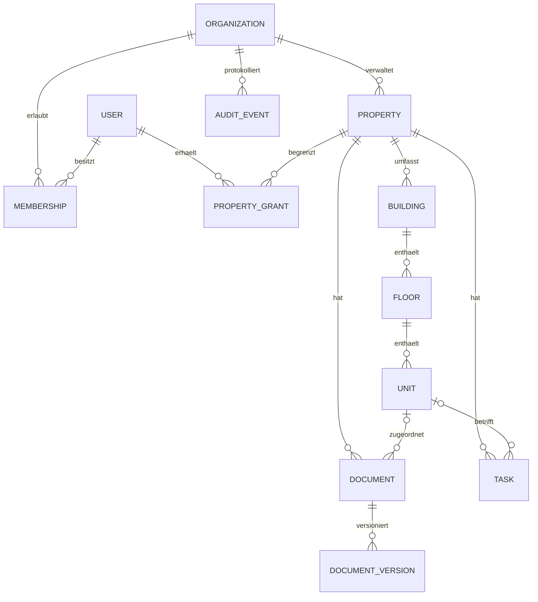

# Domänenmodell

Der Kern ordnet jede fachliche Information einer Organisation und einem berechtigten Objekt zu. Die nachfolgenden Tabellen trennen den aktuellen Kern von dem Erweiterungsmodell. Die SQL-Migrationen unter `packages/db` sind für tatsächlich angelegte Tabellen maßgeblich.

## Kern des Prototyps

| Begriff | Bedeutung und Regel |
| --- | --- |
| Organization | Mandant der Anwendung; nicht automatisch identisch mit jedem Eigentümer oder jeder verwalteten WEG |
| User, Membership | Framework-Identität und fachliche Mitgliedschaft mit Rolle; eine Sitzung allein gewährt keinen Objektzugriff |
| PropertyGrant | Zusätzliche Objektfreigabe für Rollen, die nicht den ganzen Organisationsbestand sehen dürfen |
| Property | Verwaltungsobjekt/Liegenschaft mit externer Referenz, Adresse, Herkunft und geografischem Prüfstatus |
| Building | Tatsächlicher Gebäudekörper; eine Liegenschaft kann mehrere Gebäude enthalten |
| Entrance | Optionale Erweiterung für Hausaufgänge; nur speichern und darstellen, wenn bekannt |
| Floor | Geschoss eines Gebäudes; fachlicher Name und numerisches Niveau getrennt |
| Unit | Nutzbare Einheit mit stabiler ID, Nutzungsart, Status, Fläche, Raumanzahl, Notiz und Revision |
| Document, DocumentVersion | Fachliche Zuordnung und unverwechselbare Dateiversion im privaten Objektspeicher |
| Task | Bearbeitbarer Vorgang mit Objekt-/Einheitenbezug, Status, Priorität und Frist |
| AuditEvent | Akteur, Organisation, Objektbezug, Zeitpunkt, Ereignis und nachvollziehbare Änderung |

Geografische Koordinaten und Fußabdrücke haben einen Herkunfts-/Prüfstatus. Ein ungeklärtes Objekt bleibt in der Liste und im Datenqualitätsbereich. Fehlende Koordinaten erzeugen keinen zufälligen Kartenpin. Demogeometrien tragen eine synthetische Herkunft.

Fläche und Zimmerzahl beschreiben bekannte Angaben; eine Flächenänderung ist keine rechtlich geprüfte Wohnflächenberechnung. Fehlende Werte bleiben `null`. Eine Null darf nur gespeichert werden, wenn sie fachlich zulässig und tatsächlich bekannt ist.

## Revisionen und Audit

Eine schreibende Operation übermittelt die zuletzt gelesene Revision. Die DB-Änderung prüft ID, Organisation, Objektberechtigung und Revision. Bei abweichender Revision folgt ein Konflikt; parallele Änderungen werden nicht still überschrieben. Eine erfolgreiche Änderung erhöht die Revision und schreibt das Audit-Ereignis in derselben Transaktion.

Anwendungs-Auditierung ist kein manipulationssicherer externer Beweis. Für einen Produktivbetrieb sind DB-Rechte, externe Sicherungen, Protokollintegrität und Aufbewahrung zusätzlich festzulegen.

## Erweiterungsmodell für Verwaltung und Finanzen

Diese Begriffe sind fachliche Vorgaben für weitere Slices; eine Erwähnung bedeutet noch keine implementierte Funktion.

- `ManagementMandate`: zuständige Rechtseinheit, Verwaltungsart, Verantwortliche und zeitliche Gültigkeit.
- `Party`, `LeaseParty`, `Ownership`: mehrere Mieter, Mitmieter, Eigentümer und Bevollmächtigte je Einheit mit historischen Beziehungen. Die Personendaten gehören nicht direkt in ein Kartenfeature.
- `Lease`, `RentComponent`: Mietverhältnis und zeitlich gültige Kaltmiete, Betriebs-/Heizkostenvorauszahlung, Stellplatz und andere Positionen.
- `Association`, `Resolution`, MEA: WEG-Gemeinschaft, Miteigentumsanteile und Beschlusshistorie; Gemeinschaftseigentum und Sondereigentum trennen.
- `Receivable`: Sollforderung mit Rechtseinheit, Konto, Währung, Forderungstyp, Periode und Fälligkeit.
- `BankTransaction`: unveränderbar eingelesene Istbewegung mit Provider-ID beziehungsweise belastbarem Fingerprint und Quelldokument.
- `ReconciliationSuggestion`, `PaymentAllocation`, `ApprovalDecision`: erklärbarer Vorschlag, geprüfte Zuordnung und getrennte Freigabe.
- `ImportBatch`, `ImportRecord`, `FieldMapping`, `ChangeProposal`: Herkunft, Mapping, Vorschau, Konflikt und bestätigte Übernahme.
- `Vendor`, `WorkOrder`, `Inspection`, `MeterReading`, `Asset`: Dienstleister-, Wartungs- und Anlagenprozesse mit ihren eigenen Prüf- und Fristenregeln.

## Zeit- und Finanzregeln

1. Technische Zeitpunkte werden in UTC gespeichert. Geschäftliche Perioden und Fälligkeiten richten sich nach Europe/Berlin; Perioden sind fachliche Werte, keine zufälligen UTC-Monatsgrenzen.
2. Historische Zustände besitzen Gültigkeitsintervalle. Änderungen an Eigentümern oder Mietkomponenten dürfen frühere Abrechnungsperioden nicht still verändern.
3. Geldbeträge verwenden Ganzzahl-Cents plus Währung oder exakte Dezimalwerte. Binäre Float-Arithmetik ist für Finanzberechnungen ausgeschlossen.
4. Miete, Kaution, Hausgeld, Fremdgeld und eigene Erlöse behalten getrennte Forderungstypen, Konten und Rechtseinheiten.
5. Bezahlt/teilbezahlt/offen wird aus Sollforderungen und genehmigten Zuordnungen berechnet. Ein Boolean am Mietvertrag genügt nicht.
6. Historische Finanzereignisse bleiben erhalten. Storno, Rücklastschrift und Korrektur werden als eigene referenzierte Ereignisse modelliert.
7. Fachliche Freigabe bedeutet keine automatische tatsächliche Banküberweisung und keinen automatischen Briefversand.
